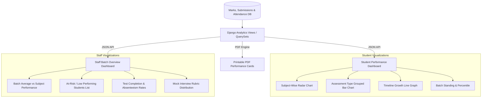

# Student Performance Portal - Analytics, Dashboards & Reporting Specification

## 1. Analytics & Visual Data Engine

The portal provides data visualizations using client-side charting libraries (**Chart.js** or **ApexCharts**), feeding from RESTful aggregation endpoints in Django.

---

## 2. Interactive Charts Specification

### 2.1 Subject Mastery Radar Chart
- **Target**: Student Dashboard
- **Purpose**: Gives an instant 360-degree view of student proficiency across all batch subjects (e.g., Python, Data Structures, Web Development, Databases, Aptitude).
- **Axes**: Subjects in the student's batch.
- **Series**:
  1. Student Score Percentage (%)
  2. Batch Average Percentage (%)

### 2.2 Assessment Type Comparison (Grouped Bar Chart)
- **Target**: Student Dashboard & Staff Student View
- **Purpose**: Analyzes student balance across the 3 test modalities:
  - Coding Tests
  - MCQ Tests
  - Mock Interviews
- **Metrics**: Allows staff and students to detect whether a student is strong in theory (MCQs) but weak in hands-on coding or verbal articulation in interviews.

### 2.3 Progress & Growth Timeline (Line Graph)
- **Target**: Student Dashboard
- **Purpose**: Displays the student's scores chronologically across all tests throughout the batch timeline.
- **Features**: Trendline showing upward or downward momentum.

### 2.4 Batch Standing & Percentile Metric
- Calculated dynamically:
  $$\text{Percentile} = \left( \frac{\text{Number of students scored below current student}}{\text{Total students in batch} - 1} \right) \times 100$$
- Visual indicator showing current Batch Rank (e.g., `#3 out of 45 students`).

---

## 3. Batch Ranking & Leaderboard Algorithm

### 3.1 Ranking Methodology
1. **Cumulative Percentage Calculation**:
   $$\text{Overall Score (\%)} = \frac{\sum \text{Marks Obtained in All Tests}}{\sum \text{Max Marks of All Tests}} \times 100$$
2. **Tie-Breaking Hierarchy**:
   - If two students have equal overall percentage:
     1. Higher score in **Coding Tests** takes precedence.
     2. Higher score in **Mock Interviews** takes precedence.
     3. Fewer test violation incidents (proctoring score) takes precedence.
     4. Roll number ascending order.

---

## 4. Downloadable PDF Performance Transcript

### 4.1 Layout & Structure
A formatted single or two-page PDF report card generated on demand using `xhtml2pdf` or `ReportLab`:
1. **Institution & Portal Header**: Logo, institution name, academic term, and issue timestamp.
2. **Student & Batch Profile**: Full Name, Roll Number, Email, Batch Code, and Admission Date.
3. **Assessment Transcript Table**:
   - Subject Code & Name
   - MCQ Test Score (Marks Obtained / Max Marks / Percentage / Grade)
   - Coding Test Score (Marks Obtained / Max Marks / Percentage / Grade)
   - Mock Interview Score (Marks Obtained / Max Marks / Percentage / Grade)
   - Subject Total & Status
4. **Qualitative Insights Section**:
   - Summary of AI recommendations on code submissions.
   - Staff commentary from the Mock Interview (Technical, Communication, and Action Items).
5. **Cumulative Standing**: Overall Percentage, Final Grade, Batch Rank, and Attendance Percentage.
6. **Verification Footer**: QR code / verification hash and signature line.

