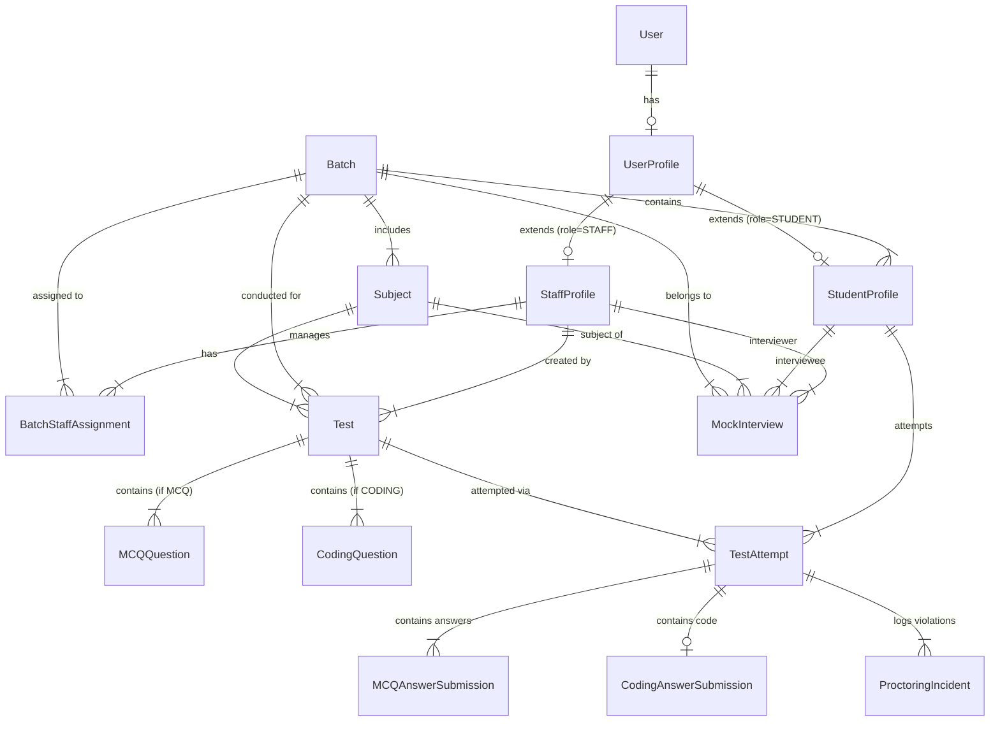

# Student Performance Portal - Database Schema & Data Models

## 1. Architectural Overview & Entity Relationships

The database is designed to enforce strict role-based access control, batch uniqueness, academic hierarchies, proctored test sessions, and AI evaluation logs.



---

## 2. Model Definitions

### 2.1 User & Authentication (`accounts`)

#### `UserProfile`
Extends Django's built-in `User` model to define system roles.
```python
class UserRole(models.TextChoices):
    SUPER_ADMIN = 'SUPER_ADMIN', 'Super Admin'
    STAFF = 'STAFF', 'Staff'
    STUDENT = 'STUDENT', 'Student'

class UserProfile(models.Model):
    user = models.OneToOneField(User, on_delete=models.CASCADE, related_name='profile')
    role = models.CharField(max_length=20, choices=UserRole.choices, default=UserRole.STUDENT)
    phone_number = models.CharField(max_length=15, blank=True)
    created_at = models.DateTimeField(auto_now_add=True)
    updated_at = models.DateTimeField(auto_now=True)
```

#### `StaffProfile`
Captures staff-specific credentials and batch assignments.
```python
class StaffProfile(models.Model):
    user_profile = models.OneToOneField(UserProfile, on_delete=models.CASCADE, related_name='staff_details')
    staff_id = models.CharField(max_length=30, unique=True)
    department = models.CharField(max_length=100)
    designation = models.CharField(max_length=100, blank=True)
```

---

### 2.2 Batches & Student Enrollment (`batches` & `students`)

#### `Batch`
Represents an isolated cohort of students.
```python
class Batch(models.Model):
    batch_code = models.CharField(max_length=50, unique=True, help_text="Unique batch identifier, e.g., FS-2026-A")
    batch_name = models.CharField(max_length=150)
    description = models.TextField(blank=True)
    start_date = models.DateField()
    end_date = models.DateField(null=True, blank=True)
    is_active = models.BooleanField(default=True)
    created_at = models.DateTimeField(auto_now_add=True)

    class Meta:
        verbose_name_plural = "Batches"
        ordering = ['-created_at']
```

#### `BatchStaffAssignment`
Many-to-many relationship linking Staff to Batches with assignment metadata.
```python
class BatchStaffAssignment(models.Model):
    batch = models.ForeignKey(Batch, on_delete=models.CASCADE, related_name='staff_assignments')
    staff = models.ForeignKey(StaffProfile, on_delete=models.CASCADE, related_name='assigned_batches')
    assigned_by = models.ForeignKey(User, on_delete=models.SET_NULL, null=True, related_name='staff_batch_assignments')
    assigned_at = models.DateTimeField(auto_now_add=True)

    class Meta:
        unique_together = ('batch', 'staff')
```

#### `Student`
Represents an enrolled student tied to exactly one Batch.
```python
class Student(models.Model):
    user_profile = models.OneToOneField(UserProfile, on_delete=models.CASCADE, related_name='student_details')
    batch = models.ForeignKey(Batch, on_delete=models.PROTECT, related_name='students')
    roll_number = models.CharField(max_length=30, unique=True)
    full_name = models.CharField(max_length=150)
    email = models.EmailField(unique=True)
    admission_date = models.DateField(auto_now_add=True)
    added_by = models.ForeignKey(User, on_delete=models.SET_NULL, null=True, related_name='students_enrolled')

    class Meta:
        ordering = ['roll_number']
```

---

### 2.3 Subjects (`subjects`)

#### `Subject`
Subjects mapped to specific batches.
```python
class Subject(models.Model):
    batch = models.ForeignKey(Batch, on_delete=models.CASCADE, related_name='subjects')
    subject_code = models.CharField(max_length=30)
    subject_name = models.CharField(max_length=150)
    description = models.TextField(blank=True)

    class Meta:
        unique_together = ('batch', 'subject_code')
```

---

### 2.4 Assessments & AI Testing Module (`tests_module`)

#### `Test`
Master entity for assessments created per subject.
```python
class TestType(models.TextChoices):
    MCQ = 'MCQ', 'Multiple Choice Question Test'
    CODING = 'CODING', 'Coding Test'

class TestStatus(models.TextChoices):
    DRAFT = 'DRAFT', 'Draft'
    PUBLISHED = 'PUBLISHED', 'Published'
    COMPLETED = 'COMPLETED', 'Completed'
    ARCHIVED = 'ARCHIVED', 'Archived'

class Test(models.Model):
    batch = models.ForeignKey(Batch, on_delete=models.CASCADE, related_name='tests')
    subject = models.ForeignKey(Subject, on_delete=models.CASCADE, related_name='tests')
    created_by = models.ForeignKey(StaffProfile, on_delete=models.SET_NULL, null=True, related_name='created_tests')
    
    title = models.CharField(max_length=200)
    test_type = models.CharField(max_length=20, choices=TestType.choices)
    status = models.CharField(max_length=20, choices=TestStatus.choices, default=TestStatus.DRAFT)
    
    total_marks = models.PositiveIntegerField(default=100)
    duration_minutes = models.PositiveIntegerField(help_text="Allowed time in minutes")
    
    start_window = models.DateTimeField(help_text="Test access window start")
    end_window = models.DateTimeField(help_text="Test access window close")
    
    source_document = models.FileField(upload_to='test_docs/%Y/%m/', null=True, blank=True)
    ai_generation_meta = models.JSONField(default=dict, blank=True)
    created_at = models.DateTimeField(auto_now_add=True)
```

#### `MCQQuestion`
Stores individual multiple-choice questions.
```python
class MCQQuestion(models.Model):
    test = models.ForeignKey(Test, on_delete=models.CASCADE, related_name='mcq_questions')
    question_text = models.TextField()
    options = models.JSONField(help_text='{"A": "Option text", "B": "Option text", "C": "Option text", "D": "Option text"}')
    correct_option = models.CharField(max_length=5, help_text="e.g. A, B, C, or D")
    explanation = models.TextField(blank=True)
    marks = models.PositiveIntegerField(default=1)
    order = models.PositiveIntegerField(default=1)
```

#### `CodingQuestion`
Stores coding challenges.
```python
class CodingQuestion(models.Model):
    test = models.ForeignKey(Test, on_delete=models.CASCADE, related_name='coding_questions')
    title = models.CharField(max_length=200)
    problem_statement = models.TextField()
    constraints = models.TextField(blank=True)
    input_format = models.TextField(blank=True)
    output_format = models.TextField(blank=True)
    sample_cases = models.JSONField(default=list, help_text='[{"input": "...", "output": "...", "explanation": "..."}]')
    evaluation_rubric = models.JSONField(default=dict, help_text="AI evaluation guidelines & hidden constraints")
    marks = models.PositiveIntegerField(default=50)
```

---

### 2.5 Test Attempts & Proctoring Engine (`test_attempts`)

#### `TestAttempt`
Tracks an individual student's session and proctoring status.
```python
class AttemptStatus(models.TextChoices):
    NOT_ATTENDED = 'NOT_ATTENDED', 'Not Attended (Absent)'
    IN_PROGRESS = 'IN_PROGRESS', 'In Progress'
    SUBMITTED = 'SUBMITTED', 'Submitted on Time'
    FORCE_SUBMITTED = 'FORCE_SUBMITTED', 'Auto-Submitted on Tab Violation'
    TIMEOUT_SUBMITTED = 'TIMEOUT_SUBMITTED', 'Auto-Submitted on Timeout'

class TestAttempt(models.Model):
    test = models.ForeignKey(Test, on_delete=models.CASCADE, related_name='attempts')
    student = models.ForeignKey(Student, on_delete=models.CASCADE, related_name='attempts')
    status = models.CharField(max_length=25, choices=AttemptStatus.choices, default=AttemptStatus.NOT_ATTENDED)
    
    start_time = models.DateTimeField(null=True, blank=True)
    submit_time = models.DateTimeField(null=True, blank=True)
    
    tab_switch_count = models.PositiveIntegerField(default=0)
    warning_count = models.PositiveIntegerField(default=0)
    
    total_score = models.DecimalField(max_digits=5, decimal_places=2, default=0.00)
    ai_evaluation_notes = models.TextField(blank=True)
    is_evaluated = models.BooleanField(default=False)
    
    class Meta:
        unique_together = ('test', 'student')
```

#### `ProctoringIncident`
Maintains an audit trail of proctoring events during the test session.
```python
class IncidentType(models.TextChoices):
    TAB_SWITCH = 'TAB_SWITCH', 'Tab or Window Switch'
    FULLSCREEN_EXIT = 'FULLSCREEN_EXIT', 'Exited Fullscreen'
    CLIPBOARD_ATTEMPT = 'CLIPBOARD_ATTEMPT', 'Copy/Paste Attempt'
    SCREENSHOT_ATTEMPT = 'SCREENSHOT_ATTEMPT', 'Screenshot Shortcut Attempt'

class ProctoringIncident(models.Model):
    attempt = models.ForeignKey(TestAttempt, on_delete=models.CASCADE, related_name='incidents')
    incident_type = models.CharField(max_length=30, choices=IncidentType.choices)
    timestamp = models.DateTimeField(auto_now_add=True)
    incident_details = models.CharField(max_length=255, blank=True)
```

#### `MCQAnswerSubmission`
Stores student answers for MCQ assessments.
```python
class MCQAnswerSubmission(models.Model):
    attempt = models.ForeignKey(TestAttempt, on_delete=models.CASCADE, related_name='mcq_answers')
    question = models.ForeignKey(MCQQuestion, on_delete=models.CASCADE)
    selected_option = models.CharField(max_length=5, blank=True)
    is_correct = models.BooleanField(default=False)
    marks_awarded = models.DecimalField(max_digits=5, decimal_places=2, default=0.00)
```

#### `CodingAnswerSubmission`
Stores code entered in the Notepad and Gemini evaluation feedback.
```python
class CodingAnswerSubmission(models.Model):
    attempt = models.ForeignKey(TestAttempt, on_delete=models.CASCADE, related_name='coding_answers')
    question = models.ForeignKey(CodingQuestion, on_delete=models.CASCADE)
    submitted_code = models.TextField()
    programming_language = models.CharField(max_length=30, default='python')
    
    ai_score = models.DecimalField(max_digits=5, decimal_places=2, default=0.00)
    ai_correctness_feedback = models.TextField(blank=True)
    ai_edge_case_feedback = models.TextField(blank=True)
    ai_code_quality_feedback = models.TextField(blank=True)
    ai_complexity_feedback = models.TextField(blank=True)
```

---

### 2.6 Mock Interviews (`mock_interviews`)

#### `MockInterview`
Manages interview scheduling, meeting platform details, email notifications, and staff grading.
```python
class InterviewStatus(models.TextChoices):
    SCHEDULED = 'SCHEDULED', 'Scheduled'
    COMPLETED = 'COMPLETED', 'Completed'
    ABSENT = 'ABSENT', 'Candidate Absent'
    CANCELLED = 'CANCELLED', 'Cancelled'

class MeetingPlatform(models.TextChoices):
    GOOGLE_MEET = 'GOOGLE_MEET', 'Google Meet'
    ZOOM = 'ZOOM', 'Zoom'
    TEAMS = 'TEAMS', 'Microsoft Teams'

class MockInterview(models.Model):
    batch = models.ForeignKey(Batch, on_delete=models.CASCADE, related_name='mock_interviews')
    subject = models.ForeignKey(Subject, on_delete=models.CASCADE, related_name='mock_interviews')
    student = models.ForeignKey(Student, on_delete=models.CASCADE, related_name='mock_interviews')
    staff = models.ForeignKey(StaffProfile, on_delete=models.CASCADE, related_name='conducted_interviews')
    
    scheduled_datetime = models.DateTimeField()
    duration_minutes = models.PositiveIntegerField(default=30)
    
    meeting_platform = models.CharField(max_length=30, choices=MeetingPlatform.choices, default=MeetingPlatform.GOOGLE_MEET)
    meeting_url = models.URLField(help_text="Google Meet or Zoom Link")
    
    status = models.CharField(max_length=20, choices=InterviewStatus.choices, default=InterviewStatus.SCHEDULED)
    email_notification_sent = models.BooleanField(default=False)
    
    # Grading & Feedback
    marks_obtained = models.DecimalField(max_digits=5, decimal_places=2, null=True, blank=True)
    max_marks = models.PositiveIntegerField(default=50)
    
    technical_skills_rating = models.PositiveSmallIntegerField(null=True, blank=True, help_text="Scale 1-10")
    problem_solving_rating = models.PositiveSmallIntegerField(null=True, blank=True, help_text="Scale 1-10")
    communication_rating = models.PositiveSmallIntegerField(null=True, blank=True, help_text="Scale 1-10")
    
    feedback_notes = models.TextField(blank=True)
    strengths = models.TextField(blank=True)
    areas_for_improvement = models.TextField(blank=True)
    
    completed_at = models.DateTimeField(null=True, blank=True)
```

