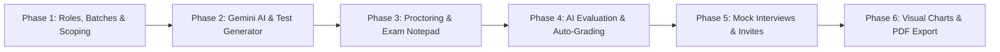

# Student Performance Portal - Implementation Roadmap & Verification Plan

## 1. Prerequisites & Dependencies

### 1.1 Python Packages
- `django >= 5.1` (or current project Django version)
- `google-genai` or `google-generativeai` (for Gemini API interaction)
- `pypdf` (for PDF text extraction)
- `python-docx` (for Word document text extraction)
- `reportlab` or `xhtml2pdf` (for PDF report generation)
- `django-environ` or `python-dotenv` (for API keys and secrets management)

### 1.2 Frontend Assets
- **Chart.js** or **ApexCharts** (via CDN or bundled static files)
- **Bootstrap 5** or **Tailwind CSS** (for responsive, modern UI)
- Code editor styling (CSS line numbers, monospaced fonts, clean notepad layout)

---

## 2. Phased Implementation Roadmap

---

### Phase 1: Access Control, Batches & Student Scoping
- **Deliverables**:
  - Update `accounts.UserProfile` with `SUPER_ADMIN`, `STAFF`, `STUDENT`.
  - Create `Batch` model with unique constraint on `batch_code`.
  - Create `BatchStaffAssignment` many-to-many model.
  - Update `Student` model to bind to `Batch`.
  - Custom RBAC decorators/mixins (`@staff_required`, `@admin_required`, `@student_required`, `@batch_access_required`).
  - Student self-registration explicitly blocked; views for Staff/Admin to add students.
- **Verification Criteria**:
  - [ ] Super Admin can create batches and assign staff.
  - [ ] Duplicate batch code raises validation error.
  - [ ] Staff only sees and adds students to assigned batches.
  - [ ] Students cannot self-register.

---

### Phase 2: Document Parsing & Gemini AI Test Generation
- **Deliverables**:
  - Integration with **Google Gemini API** (`gemini-1.5-flash`).
  - File upload handler for PDF and DOCX.
  - Text extraction service using `pypdf` and `python-docx`.
  - Structured prompt generators for:
    - MCQ Question Generation (JSON schema with 4 options, answer, explanation).
    - Coding Challenge Generation (JSON schema with problem statement, constraints, sample cases).
  - Staff review & edit interface before publishing tests.
- **Verification Criteria**:
  - [ ] Uploading a PDF/DOC extracts clean text.
  - [ ] Gemini API returns valid JSON conforming to the schema.
  - [ ] Staff can edit questions, set duration and marks, and save the test.

---

### Phase 3: Proctored Exam Room & Coding Notepad
- **Deliverables**:
  - Fullscreen exam template.
  - JavaScript Proctoring Engine:
    - Visibility change & window blur event listeners.
    - 1-warning modal overlay logic with counter tracking.
    - 2nd violation instant auto-submit trigger.
    - Clipboard (`copy`/`paste`/`cut`) block & right-click context menu disable.
    - Shortcut interception (`PrintScreen`, `F12`, `Ctrl+C`, `Ctrl+V`).
  - Countdown timer with auto-submit on `00:00`.
  - In-browser Coding Notepad with line numbers and monospace syntax layout.
- **Verification Criteria**:
  - [ ] 1st tab switch displays warning modal.
  - [ ] 2nd tab switch immediately submits test and sets status to `FORCE_SUBMITTED`.
  - [ ] Text selection and copy/paste are completely prevented.
  - [ ] Timer reaching 0 auto-submits answers.

---

### Phase 4: Automated Evaluation & Absenteeism Handling
- **Deliverables**:
  - MCQ deterministic evaluation service against answer keys.
  - AI Code Evaluator service: sends student notepad code to Gemini API with evaluation rubric and receives marks + structured feedback.
  - Absenteeism automated background job: checks for closed test windows and marks unattempted students as `ABSENT` with 0 marks.
- **Verification Criteria**:
  - [ ] MCQ submissions get instant score and explanations.
  - [ ] Submitted code is scored by Gemini with feedback for logic, edge cases, and code quality.
  - [ ] Unattempted tests are marked as Absent after window close.

---

### Phase 5: Mock Interview Scheduling & Notifications
- **Deliverables**:
  - Staff mock interview scheduling form (Batch, Student, Subject, Date/Time, Platform, Meeting URL).
  - Google Meet / Zoom URL validation.
  - HTML email dispatcher sending scheduled invitation directly to the student.
  - Staff grading interface: marks input, ratings (1-10) for technical, communication, and problem-solving, plus qualitative text feedback.
- **Verification Criteria**:
  - [ ] Staff creates schedule with Meet/Zoom link.
  - [ ] Student receives styled HTML email with date, time, and "Join Meeting" button.
  - [ ] Staff can enter score and feedback post-interview.

---

### Phase 6: Analytics, Interactive Graphs & PDF Transcripts
- **Deliverables**:
  - RESTful aggregation endpoints in `analytics/views.py`.
  - Student Dashboard with Chart.js:
    - Radar chart (Subject-wise performance).
    - Grouped Bar chart (Coding vs MCQ vs Mock Interview).
    - Line chart (Progress timeline over time).
    - Batch percentile indicator.
  - Batch Leaderboard and ranking table.
  - Staff student drill-down view.
  - Downloadable PDF performance report generation.
- **Verification Criteria**:
  - [ ] Student dashboard displays all 4 charts populated with real student test data.
  - [ ] Leaderboard calculates correct rank according to tie-breaking rules.
  - [ ] PDF report downloads cleanly with complete student scorecard and AI/staff feedback.

