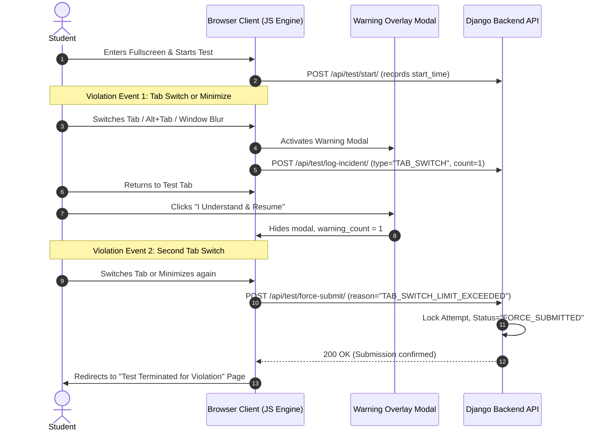
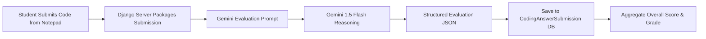

# Student Performance Portal - Proctoring & AI Pipeline Architecture

## 1. Client-Side Proctoring Engine Specification

The proctoring system enforces strict integrity standards in the student's browser during test attempts without requiring heavy native desktop software.

### 1.1 The 1-Warning Tab-Switch & Blur Detection Workflow



### 1.2 Browser Security & Restriction Matrix

```javascript
// Conceptual Implementation Pattern for Proctoring Engine

class ProctoringEngine {
  constructor(attemptId, maxWarnings = 1) {
    this.attemptId = attemptId;
    this.warningsCount = 0;
    this.maxWarnings = maxWarnings;
    this.isSubmitted = false;
    this.init();
  }

  init() {
    this.bindVisibilityEvents();
    this.bindClipboardRestrictions();
    this.bindKeyboardInterceptors();
  }

  bindVisibilityEvents() {
    // 1. Page Visibility API
    document.addEventListener("visibilitychange", () => {
      if (document.hidden && !this.isSubmitted) {
        this.handleViolation("Page hidden (Tab switch detected)");
      }
    });

    // 2. Window Blur (e.g., clicking on another app / dual monitors)
    window.addEventListener("blur", () => {
      if (!this.isSubmitted) {
        this.handleViolation("Window lost focus");
      }
    });
  }

  handleViolation(reason) {
    this.warningsCount++;
    this.reportIncidentToServer(reason, this.warningsCount);

    if (this.warningsCount <= this.maxWarnings) {
      this.showWarningModal(this.warningsCount, this.maxWarnings);
    } else {
      this.forceSubmitTest("Tab switch / window focus limit exceeded");
    }
  }

  bindClipboardRestrictions() {
    // Prevent Copy, Cut, Paste
    ['copy', 'cut', 'paste'].forEach(eventType => {
      document.addEventListener(eventType, (e) => {
        e.preventDefault();
        return false;
      });
    });

    // Disable Right-Click Context Menu
    document.addEventListener("contextmenu", (e) => {
      e.preventDefault();
      return false;
    });
  }

  bindKeyboardInterceptors() {
    document.addEventListener("keydown", (e) => {
      // Intercept DevTools, PrintScreen, Copy/Paste shortcuts
      if (
        e.key === "PrintScreen" ||
        e.key === "F12" ||
        (e.ctrlKey && e.shiftKey && (e.key === "I" || e.key === "J" || e.key === "C")) ||
        (e.ctrlKey && (e.key === "c" || e.key === "v" || e.key === "x" || e.key === "u"))
      ) {
        e.preventDefault();
        e.stopPropagation();
        return false;
      }
    });
  }

  async reportIncidentToServer(reason, count) {
    await fetch(`/api/tests/attempt/${this.attemptId}/incident/`, {
      method: "POST",
      headers: { "Content-Type": "application/json", "X-CSRFToken": getCsrfToken() },
      body: JSON.stringify({ reason, warning_count: count })
    });
  }

  async forceSubmitTest(reason) {
    this.isSubmitted = true;
    const form = document.getElementById("examForm");
    const formData = new FormData(form);
    formData.append("termination_reason", reason);

    await fetch(`/api/tests/attempt/${this.attemptId}/force-submit/`, {
      method: "POST",
      headers: { "X-CSRFToken": getCsrfToken() },
      body: formData
    });

    window.location.href = `/tests/attempt/${this.attemptId}/terminated/`;
  }
}
```

---

## 2. Google Gemini AI Integration Pipeline

### 2.1 Syllabus Document Parsing
When staff uploads syllabus notes or question blueprints:
- **PDF Extraction**: Extracted using `pypdf.PdfReader` or `pdfplumber` to retrieve plain text, headings, and code snippets.
- **DOCX Extraction**: Extracted using `docx.Document` by concatenating paragraph and table text.
- **Sanitization**: Filters redundant linebreaks and enforces a maximum token budget (e.g., 30,000 tokens) before dispatching to the Gemini API.

---

### 2.2 MCQ Question Generation Prompt

**Gemini Model**: `gemini-1.5-flash`  
**Response Schema**: `application/json`

```
SYSTEM PROMPT:
You are an expert academic examiner and curriculum specialist.
Your task is to generate high-quality Multiple Choice Questions (MCQs) strictly based on the provided source text.
Each question must test conceptual understanding, critical thinking, or practical problem-solving.
You must return only valid JSON complying strictly with the requested JSON schema.

USER PROMPT:
Generate {num_questions} MCQs for the subject "{subject_name}" targeting difficulty level "{difficulty_level}".
Total marks allocated for the test is {total_marks}. Each question must have equal marks.

Source Document:
"""
{extracted_document_text}
"""

JSON SCHEMA REQUIREMENTS:
{
  "questions": [
    {
      "question_text": "string",
      "options": {
        "A": "string",
        "B": "string",
        "C": "string",
        "D": "string"
      },
      "correct_option": "A" | "B" | "C" | "D",
      "explanation": "string explaining why the correct option is right and others are wrong",
      "marks": number
    }
  ]
}
```

---

### 2.3 Coding Challenge Generation Prompt

**Gemini Model**: `gemini-1.5-flash`  
**Response Schema**: `application/json`

```
SYSTEM PROMPT:
You are a senior software engineering instructor creating practical programming challenges.
Based on the provided syllabus content, create an algorithmic or practical programming problem.
The problem must have clear input/output requirements, edge-case constraints, and test scenarios.

USER PROMPT:
Create a coding test for the subject "{subject_name}" in programming language "{language}".
Difficulty: "{difficulty_level}". Total marks: {total_marks}.

Source Document:
"""
{extracted_document_text}
"""

JSON SCHEMA REQUIREMENTS:
{
  "title": "string",
  "problem_statement": "string markdown formatted description",
  "constraints": "string describing numerical and memory limits",
  "input_format": "string describing standard input expectations",
  "output_format": "string describing standard output expectations",
  "sample_cases": [
    {
      "input": "string",
      "output": "string",
      "explanation": "string"
    }
  ],
  "evaluation_rubric": {
    "correctness_weight": number,
    "edge_cases_weight": number,
    "quality_weight": number,
    "efficiency_weight": number,
    "hidden_test_scenarios": [
      {
        "case_name": "string",
        "scenario": "string description of edge condition"
      }
    ]
  }
}
```

---

### 2.4 In-Browser Notepad & AI Code Evaluation Engine

When the student submits their solution from the **Coding Notepad**:



#### Evaluation Prompt:
```
SYSTEM PROMPT:
You are an automated, fair, and meticulous programming evaluator.
Evaluate the student's code written in the Notepad against the problem statement and rubric provided.
Evaluate:
1. Logical correctness (Does it fulfill requirements?)
2. Edge-case resilience (Empty inputs, negative numbers, extreme values)
3. Code quality and cleanliness (Naming, structure, readability)
4. Time and space efficiency

You must be objective and assign marks out of {max_marks}.

USER PROMPT:
Problem Title: {problem_title}
Problem Statement:
{problem_statement}

Constraints & Samples:
{constraints_and_samples}

Student's Submitted Code:
```{programming_language}
{student_code}
```

Max Marks: {max_marks}

JSON SCHEMA REQUIREMENTS:
{
  "marks_awarded": number (between 0 and max_marks),
  "is_fully_correct": boolean,
  "correctness_feedback": "string explaining logical correctness",
  "edge_case_feedback": "string explaining how edge cases were handled",
  "code_quality_feedback": "string detailing readability and clean-code practices",
  "efficiency_feedback": "string analyzing time/space complexity",
  "suggestions_for_improvement": ["string", "string"]
}
```

---

## 3. Mock Interview Scheduling & Email Notification Architecture

### 3.1 Scheduling Flow
1. Staff navigates to `/mock-interviews/schedule/`.
2. Form fields:
   - **Batch**: Dropdown filtered to staff's assigned batches.
   - **Subject**: Dropdown filtered to subjects in selected batch.
   - **Student**: Dropdown of enrolled students in batch.
   - **Date & Time**: Datetime picker.
   - **Duration**: Dropdown (e.g., 20 mins, 30 mins, 45 mins).
   - **Meeting Platform**: Radio selection (`Google Meet` / `Zoom`).
   - **Meeting URL**: Direct URL (e.g., `https://meet.google.com/abc-defg-hij` or `https://zoom.us/j/123456789`).
   - **Topics / Instructions**: Textarea.

### 3.2 Email Notification Dispatcher
Upon saving, Django triggers an email via `django.core.mail.send_mail`:

```html
<!-- Responsive Email Template Preview -->
<div style="font-family: Arial, sans-serif; max-width: 600px; margin: auto; padding: 20px; border: 1px solid #e0e0e0; border-radius: 8px;">
  <h2 style="color: #1a73e8;">Mock Interview Scheduled</h2>
  <p>Dear <strong>{{ student_name }}</strong>,</p>
  <p>Your mock interview for <strong>{{ subject_name }}</strong> has been scheduled with <strong>{{ staff_name }}</strong>.</p>
  
  <div style="background-color: #f8f9fa; padding: 15px; border-left: 4px solid #1a73e8; margin: 20px 0;">
    <p style="margin: 4px 0;"><strong>Date & Time:</strong> {{ scheduled_time }}</p>
    <p style="margin: 4px 0;"><strong>Duration:</strong> {{ duration_minutes }} minutes</p>
    <p style="margin: 4px 0;"><strong>Platform:</strong> {{ meeting_platform }}</p>
  </div>

  <div style="text-align: center; margin: 30px 0;">
    <a href="{{ meeting_url }}" style="background-color: #1a73e8; color: white; padding: 12px 24px; text-decoration: none; border-radius: 5px; font-weight: bold; display: inline-block;">
      Join {{ meeting_platform }} Meeting
    </a>
  </div>

  <p><strong>Instructions:</strong> {{ instructions }}</p>
  <p style="color: #666; font-size: 12px; margin-top: 30px;">This is an automated notification from Student Performance Portal.</p>
</div>
```

